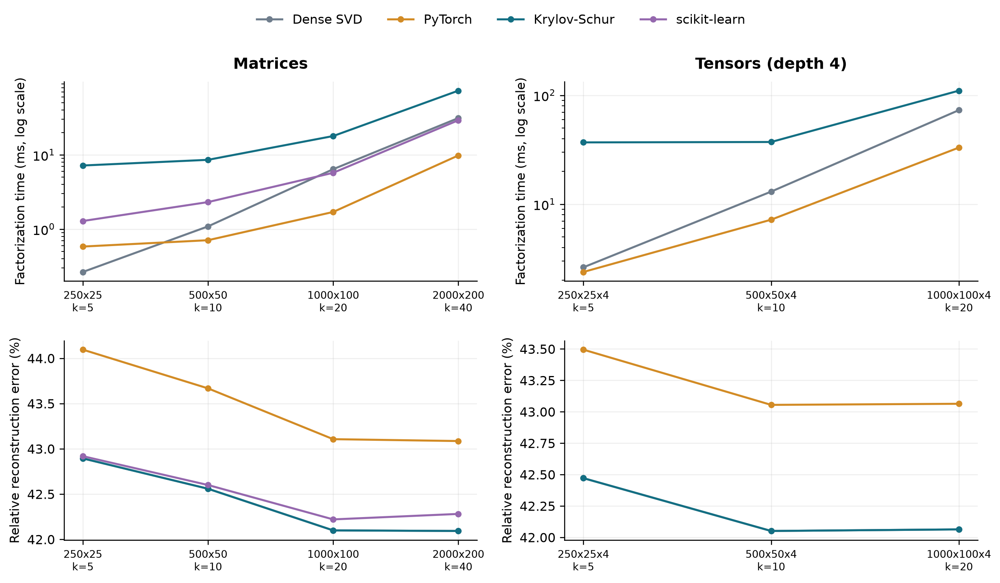

# Matrix and tensor SVD with Krylov-Schur

This project uses Krylov-Schur to keep a few main components of a matrix or
tensor and rebuild data close to the input. A tensor here is a three-dimensional
array. The code uses an FFT along its third axis, works on each matrix slice,
and transforms the factors back. A Gram matrix gives a small basis, and a small
SVD gives the final factors.

[Numerical checks](docs/verification.md)

## Run the comparison

From the repository root in PowerShell:

```powershell
./.venv/Scripts/python.exe -m experiments.compare --suite all --repeats 5
```

`experiments/compare.py` is the main experiment script. It compares dense NumPy SVD,
PyTorch low-rank SVD, Krylov-Schur SVD, and scikit-learn's matrix-only
`TruncatedSVD`. Every method receives the same input and requested rank.

The script writes:

- `results/metrics.csv`: dimensions, rank, time, absolute error, and relative error.
- `results/metrics.json`: timing samples, parameters, environment, and warnings.
- `results/comparison.png` and `.svg`: matrix/tensor size comparisons.
- `results/depth.png` and `.svg`: tensor-depth comparisons.
- `results/tensor_comparison.png` and `.svg`: compact tensor figure for the paper.

Use `--suite quick --repeats 2` for a small run, `--suite scaling` for dimension
sweeps, or `--suite original` for six small/large reference cases. Set
`--output PATH` to write a separate result set. Running the default command
replaces files in `results/`.

## Measured speed and accuracy

Measurements use synthetic uniform random arrays, one CPU thread, one warm-up,
and the median of five timed factorizations. Input generation, imports,
reconstruction, error calculation, and plotting are outside the timer.
Tensor timings include FFTs and factor inverse FFTs.

Relative error is `||A - approximation||_F / ||A||_F`. Lower is better.
A positive value measures the information lost when components are removed.

| Shape | Rank | PyTorch ms | Krylov-Schur ms | PyTorch error | Krylov-Schur error |
| --- | ---: | ---: | ---: | ---: | ---: |
| 500x50 | 10 | 0.711 | 8.566 | 43.6675% | 42.5587% |
| 2000x200 | 40 | 9.811 | 72.950 | 43.0858% | 42.0924% |
| 500x50x4 | 10 | 7.200 | 37.236 | 43.0548% | 42.0507% |
| 1000x100x10 | 30 | 114.591 | 342.836 | 39.4232% | 38.1137% |
| 10x7x2 | 6 | 0.715 | 2.109 | 4.8930% | 4.8755% |

Krylov-Schur takes longer than both PyTorch and dense SVD in
all 15 test cases. Its error matches the dense reference to floating-point
precision. It has less error than the tested PyTorch settings, but takes more
time. PyTorch uses `q=k` and two power iterations. Krylov-Schur keeps working
toward its stopping tolerance. The methods are not tuned to reach the same
target error.



Dense SVD and Krylov-Schur error lines overlap. The size tests use
`q=10p`, `k=p/5`, and restart dimension `r=2k`; tensor depth is 4.
The separate depth test holds shape `500x50` and rank 10 fixed while varying
depth over 2, 4, and 8.

## Computational cost

Let `p=min(n1,n2)`, `q=max(n1,n2)`, and `r` be the restart dimension.
Building the dense Gram matrix alone costs `O(q p^2)`. With `R` restart
cycles, an estimate of the work is

```text
O(q p^2 + R (p^2 r + p r^2 + r^3) + q p k).
```

Dense SVD also has main cost `O(q p^2)`. Forming the Gram matrix keeps that
main order of work, even if the later SVD is smaller. For depth `d`,
the tensor method needs about `d` matrix decompositions and
`O(q p d log d)` FFT work. These are operation-count estimates, distinct
from measured wall-clock time. Peak memory was not measured.

## Setup and tests

Tested on Windows 11, CPython 3.11.9, Intel Core i5-8365U, CPU-only PyTorch.
No external dataset or GPU is required. Select an installed Python 3.11
interpreter for `python`, then run:

```powershell
python -m venv .venv
./.venv/Scripts/python.exe -m pip install -r requirements.txt
./.venv/Scripts/python.exe -m unittest discover -s tests -v
./.venv/Scripts/python.exe -m experiments.compare --suite quick --repeats 2
```

The 11 numerical tests cover real/complex matrices, small singular values,
zero/rank-deficient inputs, convergence, tensor convolution/adjoints, and
dense SVD reference errors. Direct dependencies are pinned; transitive
dependencies are not fully locked. Other systems and GPU runs are unverified.

## Files and factor conventions

```text
krylov_tsvd/             Calculation code
  krylov_schur.py        Krylov-Schur iteration and helpers
  tensor_svd.py          Matrix SVD and tensor operations
experiments/compare.py   Timing, errors, CSV/JSON, and plots
examples/demo.py         Small matrix/tensor example
tests/                  Numerical tests
docs/                   Paper source and numerical checks
results/                Recorded measurements and plots
```

`our_svd(B,k,m,maxIt,tol)` returns `(U,S,V)`; reconstruct with
`U @ S @ V.conj().T`. It requires `1 <= k < m <= min(B.shape)`.
`scipy_svd` returns `(U,S,VT)` instead.
For tensor factors, use `tProduct(U,tProduct(S,kilmer_transposs(V)))`.
`kilmer_transposs` computes the tensor conjugate transpose.

Run the small example with `python -m examples.demo`. Import the calculations
from `krylov_tsvd.tensor_svd` or `krylov_tsvd.krylov_schur`.

## Scope

Forming the Gram matrix can make very small components harder to compute
accurately. Difficult matrices and large sparse inputs need more tests.
All test data are random, with seed 0 for data and seed 1 for the solvers.
These results do not show performance on every dataset or prove that the
mathematical method is new.

The Gram-matrix strategy has a close existing implementation in the
[Anasazi SVD example](https://github.com/trilinos/Trilinos/blob/trilinos-release-12-18-1/packages/anasazi/epetra/example/BlockKrylovSchur/BlockKrylovSchurEpetraExSVD.cpp).
[Stoll's paper](https://doi.org/10.1016/j.laa.2011.07.022) instead combines
Krylov-Schur with Lanczos bidiagonalization. The tensor framework follows the
[t-product/tensor SVD literature](https://doi.org/10.1016/j.laa.2010.09.020).
See [LICENSE](LICENSE) for the repository license.

