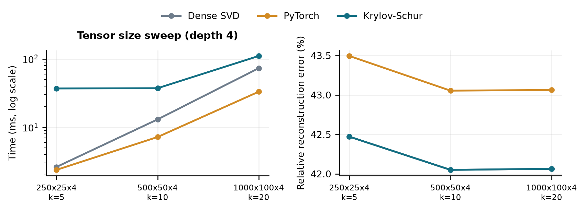

# Computing t-SVD with Krylov-Schur

**Summary.** This project combines Krylov-Schur with FFT-based t-SVD to approximate three-dimensional arrays using fewer components. Tests with random data show dense-t-SVD accuracy and less error than the tested PyTorch version, at greater runtime than both methods.

## Method

An FFT turns the tensor into matrix slices. For each slice `B`, Krylov-Schur finds a small basis `Q` using `B* B` or `B B*`, called a Gram matrix (`*` means conjugate transpose). A small SVD gives the factors; inverse FFTs give the tensor factors. Error is `||A - A_k||_F / ||A||_F`, where `A_k` is the rebuilt tensor. Lower is better.

## Contribution of this work

This work replaces the dense SVD in each FFT slice with a Gram-based restarted Krylov-Schur solver. It also compares error and time across sizes and includes Gram formation in the cost. The contribution is this tensor implementation and its tests. The underlying methods already exist [1-3]; this study does not establish that the full combination is new.

## Tests and results

The 15 matrix/tensor cases use random data in `[0,1)` and fixed seeds (data: 0, solver: 1). Each method uses the same data and rank `k` (number of kept components). Times are medians of five runs after one warm-up, on one Intel Core i5-8365U CPU thread. They include FFTs and Gram formation, but exclude rebuilding and error checks. PyTorch uses `q=k` and two power iterations; Krylov-Schur uses tolerance `2e-16`. Target errors are not matched.

*Figure 1. Time and error at three tensor sizes. Depth is 4, `k` is one fifth of the smaller matrix dimension, and the restart size is `2k`. Dense and Krylov-Schur error lines overlap. The error axis starts above zero to show the difference.*

| Tensor shape | Rank | PyTorch time | Krylov-Schur time | PyTorch error | Krylov-Schur error |
| --- | ---: | ---: | ---: | ---: | ---: |
| 250 x 25 x 4 | 5 | 2.38 ms | 36.93 ms | 43.49% | 42.47% |
| 1000 x 100 x 4 | 20 | 33.09 ms | 110.31 ms | 43.06% | 42.06% |
| 1000 x 100 x 10 | 30 | 114.59 ms | 342.84 ms | 39.42% | 38.11% |

Krylov-Schur matches dense-SVD error to floating-point precision in all 15 cases, but takes longer than both methods. For the largest tensor, dense t-SVD takes 232.23 ms with 38.11% error. Krylov-Schur takes about three times as long as PyTorch, with 1.31 percentage points less error. No speed gain appears at the tested sizes. Real datasets still need testing.

## Computational cost

Let `p=min(n1,n2)`, `q=max(n1,n2)`, `r` be the restart size, and `R` the restart count. Estimated work per matrix is `O(q p^2 + R(p^2 r + p r^2 + r^3) + q p k)`. A depth-`d` tensor needs `d` matrix steps and `O(q p d log d)` FFT work. Gram formation alone costs `O(q p^2)`, the same main order as dense SVD. It can harm accuracy for small singular values. Peak memory was not measured.

## References

1. Kilmer, M. E., and Martin, C. D. *Factorization strategies for third-order tensors*. LAA 435, 641-658. [doi:10.1016/j.laa.2010.09.020](https://doi.org/10.1016/j.laa.2010.09.020).
2. Stoll, M. *A Krylov-Schur approach to the truncated SVD*. LAA 436, 2795-2806. [doi:10.1016/j.laa.2011.07.022](https://doi.org/10.1016/j.laa.2011.07.022).
3. Trilinos/Anasazi, release 12.18.1. [BlockKrylovSchurEpetraExSVD.cpp](https://github.com/trilinos/Trilinos/blob/trilinos-release-12-18-1/packages/anasazi/epetra/example/BlockKrylovSchur/BlockKrylovSchurEpetraExSVD.cpp).

